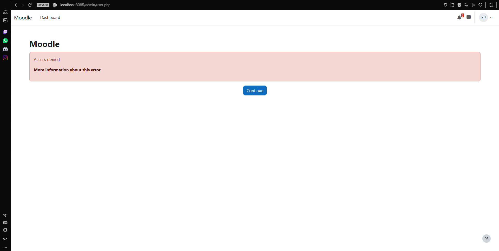
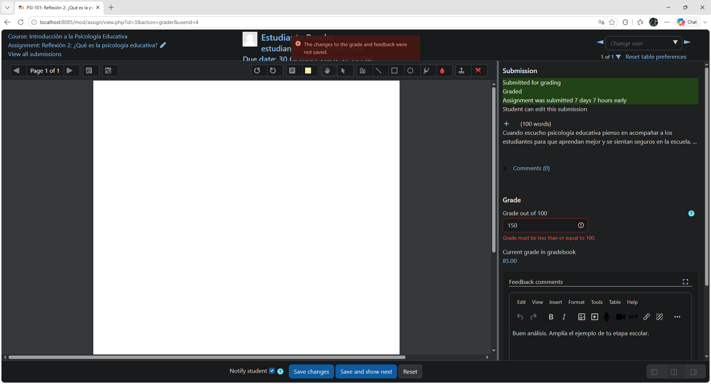
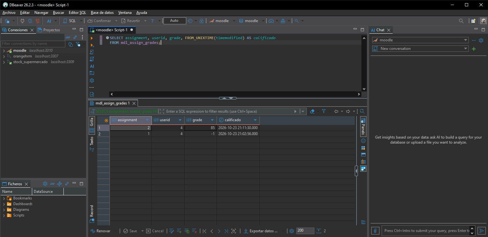
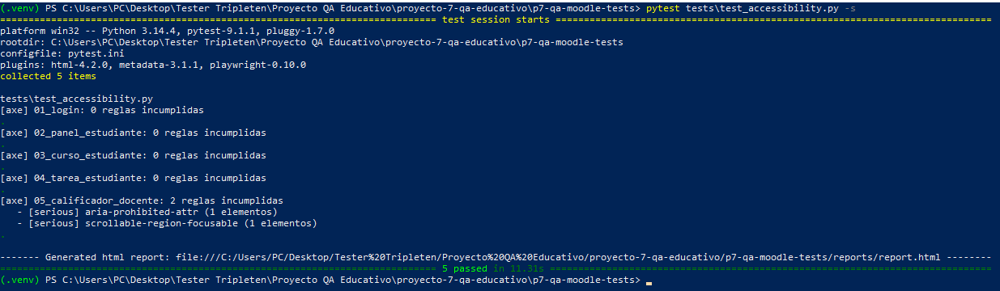

# Proyecto 7 — QA de una plataforma educativa (Moodle LMS)

Informe de QA, automatización y validación de datos sobre **Moodle 5.2.4** para una academia en línea ficticia (*Aula Horizonte*). Foco: **roles y permisos, ciclo de tareas y calificaciones, accesibilidad** y experiencia de aprendizaje.

> Proyecto de portafolio independiente. La empresa y sus requerimientos son ficticios; el sistema bajo prueba (Moodle) y los resultados son reales y reproducibles en local.

## Descripción

Antes de abrir un ciclo de cursos, el equipo de calidad necesita saber si la plataforma protege lo que debe proteger (permisos entre roles), si el ciclo de una tarea funciona de punta a punta (crear, entregar, calificar) y si lo que muestra la pantalla coincide con la base de datos. El proyecto responde a eso con pruebas manuales, doble validación en SQL y una suite automatizada.

## Resultados en una mirada

| Indicador | Resultado |
|---|---|
| Casos de prueba diseñados y ejecutados | 20 (17 pasan, 2 pasan con hallazgos, 1 observación) |
| Requerimientos funcionales cubiertos | 10 de 10 |
| Validaciones SQL contra la interfaz | 7 de 7 coinciden |
| Pruebas automatizadas (Playwright + axe-core) | 15 de 15 pasan (4.ª corrida, 22 s) |
| Defectos confirmados | 3 (1 visual baja, 2 de accesibilidad media) |
| Observaciones de mejora | 4 |

## Tecnologías

| Área | Herramienta |
|---|---|
| Sistema bajo prueba | Moodle 5.2.4 (imagen `oksigenia/moodle:5.2`), MariaDB 11.4, PHP 8.4 |
| Entorno | Docker Desktop y Docker Compose |
| Validación de datos | DBeaver Community (SQL) |
| Automatización E2E | Playwright (Python) con pytest y pytest-html |
| Accesibilidad | axe-core (axe-playwright-python), WCAG 2.0/2.1 A y AA |
| Evidencia y control de versiones | Capturas nombradas por caso, Git y GitHub |

## Objetivos

- Verificar que cada rol (administrador, docente, estudiante) solo accede a lo que le corresponde.
- Validar el ciclo de la tarea: creación, entrega con límite de 100 palabras, calificación 0–100 y entrega tardía.
- Comprobar con SQL que interfaz y base de datos dicen lo mismo.
- Automatizar la regresión de los flujos críticos y escanear accesibilidad en pantallas clave.
- Documentar solo hallazgos reales, con evidencia.

## Estructura del proyecto

```text
proyecto-7-qa-educativo/
├── README.md
├── docker-compose.yml        # Moodle + MariaDB (lee las contraseñas de .env)
├── .env.example              # Plantilla de variables (sin contraseñas reales)
├── docs/
│   └── Informe_QA_Proyecto7_Moodle.docx   # Informe completo con evidencias
├── casos-de-prueba/
│   └── casos_de_prueba_P7.csv
├── reporte-de-bugs/
│   └── BUGS.md
├── sql/
│   └── validaciones.sql      # Las 7 consultas de la doble validación
├── automatizacion/           # Playwright + axe-core (ver su propio README)
│   ├── tests/
│   ├── conftest.py
│   └── reports/              # report.html y axe_*.json de la corrida final
└── evidencias/               # Capturas P7_<caso>_<rol>_<descripcion>.png
```

## Cómo revisar el proyecto

1. **5 minutos:** abre `docs/Informe_QA_Proyecto7_Moodle.docx`; la sección 11 resume cobertura, defectos, riesgos y recomendaciones.
2. **Casos y defectos:** `casos-de-prueba/casos_de_prueba_P7.csv` y `reporte-de-bugs/BUGS.md`.
3. **Evidencia:** carpeta `evidencias/`; cada archivo indica caso, rol y qué se ve.
4. **Datos:** `sql/validaciones.sql` junto con las capturas `P7_SQL_*`.
5. **Automatización:** `automatizacion/reports/report.html` y los `axe_*.json`.

## Cómo reproducir el entorno

```bash
cp .env.example .env        # y completa las contraseñas
docker compose up -d
# Moodle:  http://localhost:8085
# MariaDB: localhost:3310 (DBeaver; base y usuario "moodle")
```

Después hay que crear el curso PSI-101 y los usuarios `docente.qa` (Teacher) y `estudiante.qa` (Student), como se describe en el informe.

## Cómo ejecutar la automatización

```bash
cd automatizacion
python -m venv .venv && source .venv/bin/activate      # Windows: .venv\Scripts\Activate.ps1
pip install -r requirements.txt
playwright install chromium
cp .env.example .env     # completa las contraseñas de los tres usuarios
pytest                   # genera reports/report.html
pytest tests/test_accessibility.py -s   # lista las reglas de axe-core por página
```

## Capturas

| Permisos del estudiante | Calificador: nota fuera de rango rechazada |
|---|---|
|  |  |

| Doble validación SQL | Accesibilidad con axe-core |
|---|---|
|  |  |

## Hallazgos

| ID | Título | Severidad |
|---|---|---|
| BUG-001 | La línea «Due date» del encabezado del calificador aparece cortada | Baja |
| BUG-002 | El separador «Resize layout» del calificador usa `aria-label` sin un rol válido | Media |
| BUG-003 | La región desplazable `.drawingregion` del calificador no es accesible con teclado | Media |

Las cuatro observaciones de mejora (privacidad del último acceso, fecha límite vencida sin aviso, idioma de la interfaz y contador de notificaciones) están en el informe, sección 9.

## Aprendizajes

- Distinguir un fallo de la prueba de un defecto del producto: la suite necesitó cuatro corridas y los tres primeros fallos eran míos.
- Un servidor local lento puede parecer un defecto; reducir los inicios de sesión repetidos estabilizó las pruebas.
- La doble validación (interfaz y SQL) da confianza que una sola capa no da.
- La accesibilidad automatizada encuentra poco, pero concreto; lo que falta es confirmarlo a mano con teclado.

## Limitaciones y mejoras futuras

No se ejecutó: carga (k6), seguridad (OWASP ZAP), API de Moodle (Postman/Newman), integración continua (GitHub Actions), cuestionarios ni pruebas en móvil o en otros navegadores. Siguientes pasos: pruebas manuales de teclado y lector de pantalla para BUG-002 y BUG-003, configurar el idioma español en el entorno y automatizar la creación de datos de prueba para correr la suite en CI.

## Conclusiones

La plataforma cumple los requisitos funcionales de permisos, tareas y calificaciones probados, y la base de datos refleja fielmente lo que muestra la interfaz. Los defectos se concentran en la vista del docente (calificador) y son de severidad baja y media; ninguno bloquea la apertura del ciclo.

## Autor

**Christian Jacinto Arjona** — Psicólogo educativo en transición a QA Engineer.
